# Nem Bank

[](https://github.com/onielsteve2003/nem-bank/actions/workflows/ci.yml) [](https://github.com/onielsteve2003/nem-bank/actions/workflows/codeql.yml)

A mobile-first digital bank for Nigerians, with multi-currency wallets, scam and fraud protection, digital ajo and an AI assistant. It's built with React Native (Expo), Go and PostgreSQL.

> [!IMPORTANT]
> **Demo disclaimer.** Nem Bank is a portfolio project, not a bank. It is not licensed by the CBN or any regulator, holds no deposits and moves no real money. Every balance, customer, card and transaction is simulated. Never enter real card, BVN, NIN or bank details. The same notice is shown on the welcome screen, in Settings → About and on every statement.

<p align="center">
  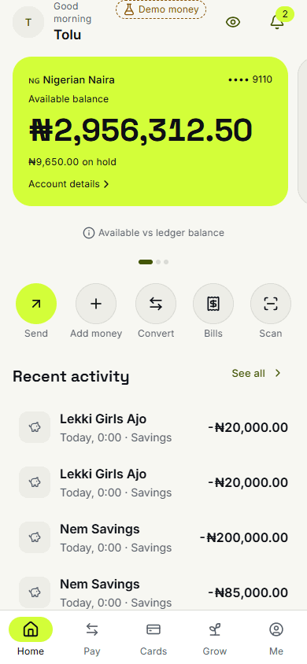
</p>

## Live demo

| Where                      | Link                                                                                                                                                                                                  |
| -------------------------- | ----------------------------------------------------------------------------------------------------------------------------------------------------------------------------------------------------- |
| Web demo (Vercel)          | https://nem-bank-fodx.vercel.app: tap **Try the demo**. The demo PIN is `2580`                                                                                                                        |
| iPhone / Android (Expo Go) | [EAS Update `preview` channel](https://expo.dev/accounts/onielsteve/projects/nem-bank): install Expo Go, open the latest update and scan its QR code                                                  |
| Android APK (EAS Build)    | [Install page](https://expo.dev/accounts/onielsteve/projects/nem-bank/builds/3ce0be78-39c3-4950-8588-8f23f3ee79e7): open it on an Android phone, tap **Install** and allow installs from your browser |
| Staff console (Vercel)     | https://nem-console.vercel.app: pick a demo staff account on the login page (password `nem-console-demo`, code from the on-page authenticator)                                                        |
| Developer portal           | https://nem-console.vercel.app/developers · [API reference](https://nem-console.vercel.app/api-reference.html)                                                                                        |

The web demo and the console redeploy on every push to `main` (the console only when it or a shared package changed).

## Screenshots

| Welcome                                                                                                                                | Home                                                                                                                               | Home, dark theme                                                                                           |
| -------------------------------------------------------------------------------------------------------------------------------------- | ---------------------------------------------------------------------------------------------------------------------------------- | ---------------------------------------------------------------------------------------------------------- |
| 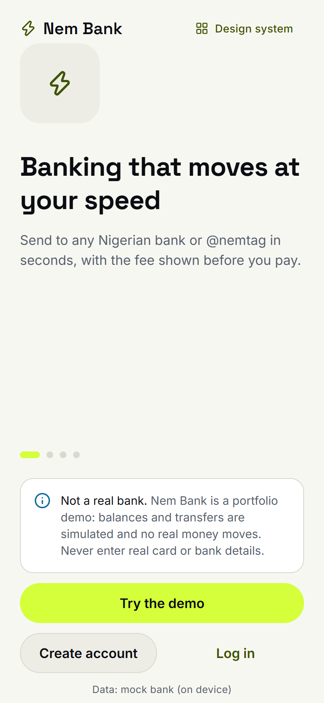             | 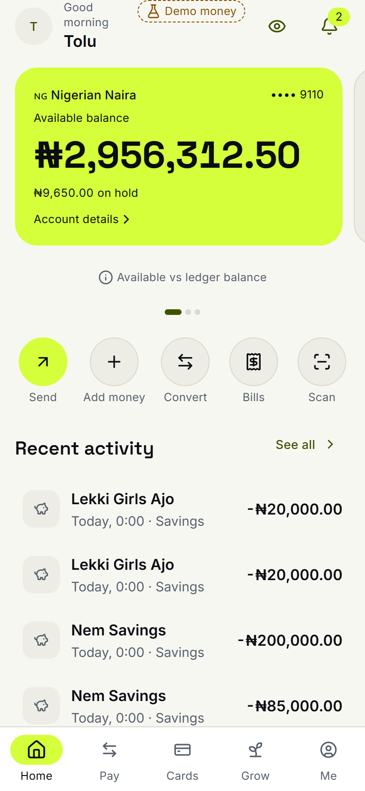      | 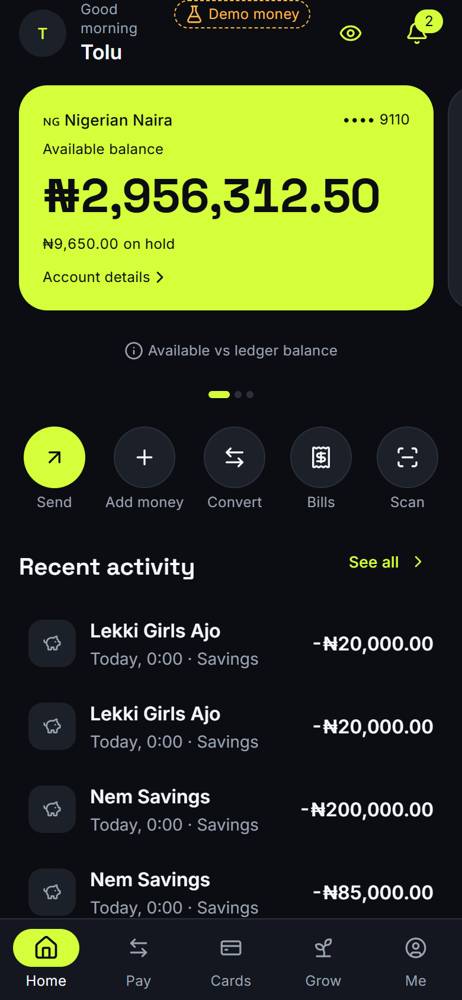      |
| **Pay**                                                                                                                                | **Cards**                                                                                                                          | **Grow (savings and ajo)**                                                                                 |
| 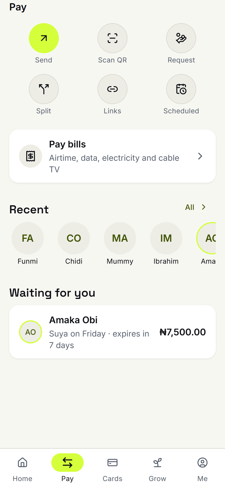    | 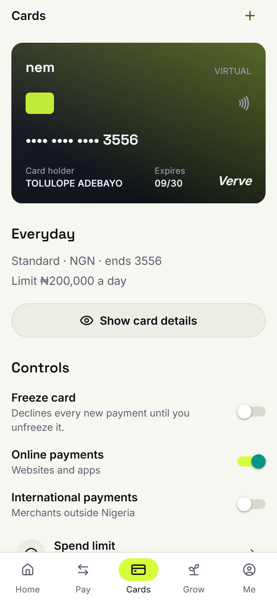 | 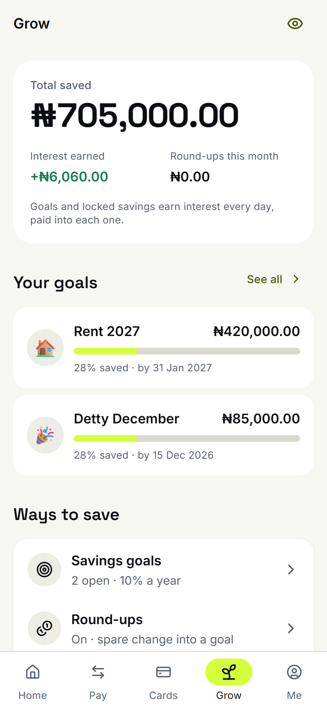 |
| **Nem Assistant**                                                                                                                      |                                                                                                                                    |                                                                                                            |
| 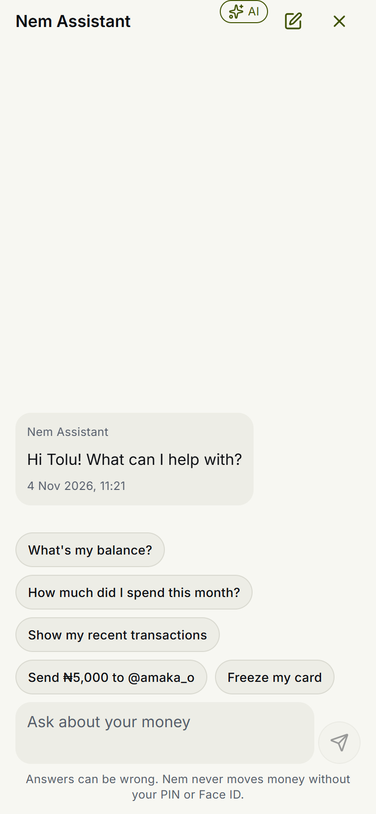 |                                                                                                                                    |                                                                                                            |

**Staff console**

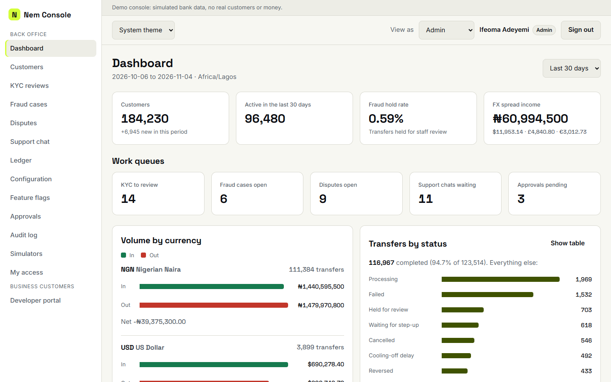

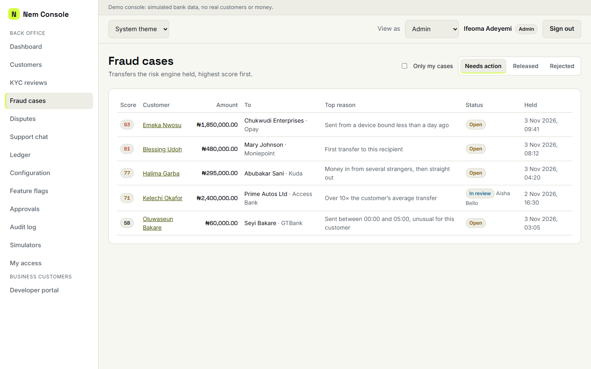

## What's inside

- **Money that adds up.** Amounts are integer minor units in a shared `Money` type, never floats. Transfers are priced before you confirm, holds show as "available vs ledger" balance, and FX quotes are held for a fixed window.
- **Scam and fraud protection.** A risk engine scores every transfer with reason codes (new device, first-time recipient, unusual hour, mule patterns). Risky payments are held for staff review in the console, and there's a new-device cool-off and a panic button.
- **Device-bound security.** Transaction PIN with weak-PIN rules and lockout, biometric approval, per-device signing keys, auto-lock and an app-switcher privacy overlay.
- **Ajo, savings and credit.** Digital rotating savings groups, savings goals with round-ups, and a transparent credit offer.
- **AI with guard rails.** The assistant can answer questions and _prepare_ payments, but only your PIN or biometrics can send money. Every AI feature has a non-AI fallback, a settings toggle and a "why" explanation.
- **For everyone.** English and Nigerian Pidgin, light and dark themes, low-data and reduce-motion modes, screen-reader labels throughout (audited with axe and VoiceOver).
- **The bank's side.** A staff console for KYC review, fraud cases, disputes, support chat, ledger and reconciliation, feature flags, maker-checker approvals and a hash-chained audit log, plus a developer portal with API keys and webhooks.

## Architecture

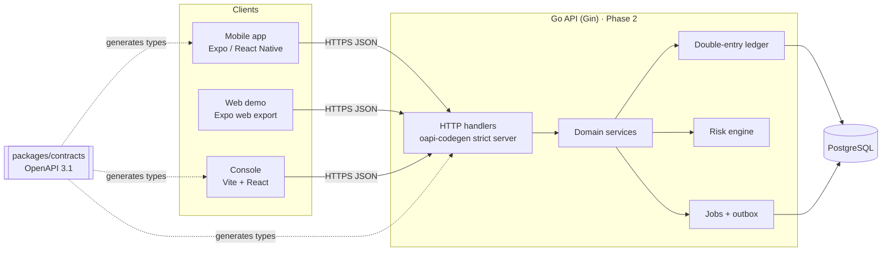

- **Contract first.** `packages/contracts/openapi.yaml` is the single source of truth. The apps import types generated from it, and the Go server will be generated from the same file.
- **Repositories behind interfaces.** Screens talk to repositories, never to `fetch`. Today every client runs against an in-app **mock bank** that implements the contract with seeded data, so the demos work with no server. Pointing the app at the real API is a config change (`EXPO_PUBLIC_API_MODE=http`), not a rewrite.
- **Modular monolith.** The Go API (Phase 2, not built yet) is one service with domain packages (ledger, transfers, fx, cards, savings, ajo, risk and more) on one Postgres, with jobs running in-process.
- **Expo Go only.** The mobile app uses only modules that ship in Expo Go, so it runs on a real iPhone without a Mac or a paid Apple account.

## Repository layout

A [pnpm workspaces](https://pnpm.io/workspaces) monorepo:

| Path                 | What it is                                                                        |
| -------------------- | --------------------------------------------------------------------------------- |
| `apps/mobile`        | The customer app: Expo + React Native, running in Expo Go, Android and on the web |
| `apps/console`       | Staff back-office and developer portal (Vite + React)                             |
| `apps/api`           | Go API with a double-entry ledger and PostgreSQL (Phase 2)                        |
| `packages/shared`    | `@nem/shared`: the money type, currencies, validation schemas and design tokens   |
| `packages/contracts` | `@nem/contracts`: the OpenAPI contract and the TypeScript types generated from it |
| `docs`               | Screenshots and project documentation                                             |

## How to run

Requirements: Node 22 LTS (see `.nvmrc`) and pnpm 11 (`corepack enable`). For a phone, install **Expo Go** from the App Store or Play Store.

```bash
pnpm install
```

**Mobile app on your phone**

```bash
pnpm dev              # starts Expo; scan the QR code with the iPhone camera or the Expo Go app
```

The phone and the computer must be on the same Wi-Fi.

**Mobile app in a browser**

```bash
pnpm --filter mobile web    # opens http://localhost:8081
pnpm build:web              # static export to apps/mobile/dist (what Vercel serves)
```

**Staff console**

```bash
pnpm console          # opens http://localhost:5173
```

On either app, use the demo accounts: **Try the demo** (PIN `2580`) in the mobile app, or any staff account listed on the console login page.

**Checks**

```bash
pnpm check            # lint, typecheck and test every workspace (what CI runs)
```

## API contract

After editing `packages/contracts/openapi.yaml`:

```bash
pnpm --filter @nem/contracts lint       # Redocly lint
pnpm --filter @nem/contracts generate   # regenerate src/schema.gen.ts
```

Import API types from `@nem/contracts`; never hand-write them.

## Paid feature policy

Nem Bank costs $0 to run. Everything is built in the app, and everything that can work for free does. A feature that would need a paid partner is still fully designed, but instead of failing it opens a **Paid Feature Notice**: a bottom sheet that says which partner it needs and shows how the integration would work.

| Feature                                                                                                | Status                                                               |
| ------------------------------------------------------------------------------------------------------ | -------------------------------------------------------------------- |
| Transfers between Nem users, ledger, virtual cards, FX, savings, ajo, credit, bills (simulated biller) | **Fully working** (simulated money)                                  |
| Transfers to other banks                                                                               | **Sandbox** (simulated NIBSS-style rail)                             |
| BVN / NIN verification                                                                                 | **Sandbox** (test numbers)                                           |
| Inbound foreign currency                                                                               | **Simulated** (Demo Controls in the app)                             |
| SMS OTP, USSD                                                                                          | **Paid Feature Notice** (email OTP and device keys are used instead) |
| International transfers out (SWIFT / remittance)                                                       | **Paid Feature Notice**                                              |
| Physical cards                                                                                         | **Paid Feature Notice**                                              |
| Real-money mode (licensed banking-as-a-service partner)                                                | **Paid Feature Notice** (a feature flag in the console)              |

Each partner sits behind an interface (`BankPartner`, `Biller`, `KycProvider`, `CardProcessor`, `LlmProvider`, `Mailer`), so going live means adding an adapter, not rewriting a feature.
