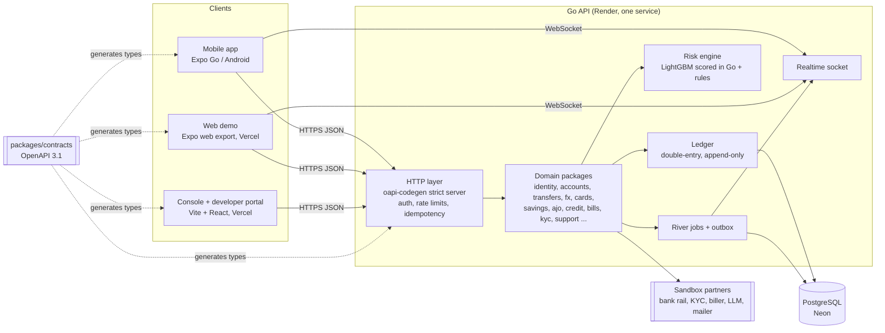
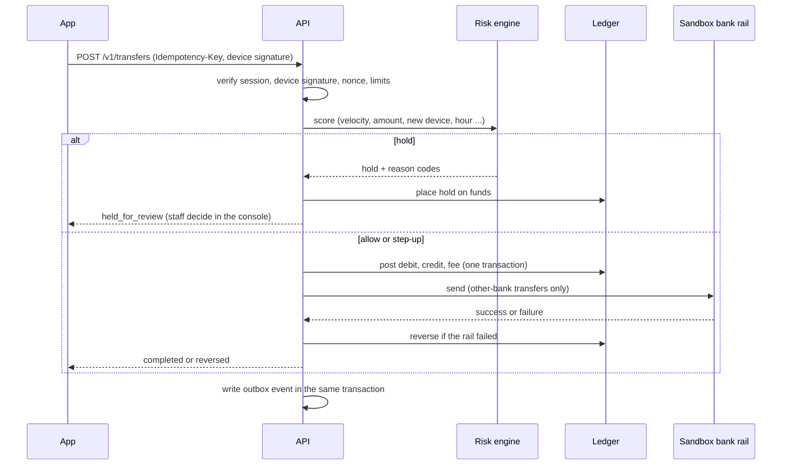

# Architecture

Nem Bank is a pnpm monorepo with three apps and two shared packages. This page shows how the pieces fit and how money moves. The decisions behind it are in [adr/](adr/README.md).

## System

- **One service, one database.** The API is a modular monolith. Each domain is a package under `apps/api/internal` and owns its tables and SQL (sqlc). Domains talk through Go interfaces and through events, never through each other's tables.
- **Contract first.** `packages/contracts/openapi.yaml` (278 operations) generates the TypeScript types for both apps and the Go server stubs. A change to the contract that one side does not follow fails the build.
- **Repositories behind interfaces.** Screens call repositories. `EXPO_PUBLIC_API_MODE` picks the on-device mock bank (instant, offline) or the real API. Both implement the same contract, so the same screens run on either.

## How a transfer moves

- **Idempotent.** The same `Idempotency-Key` returns the same transfer. The load test replayed 76 requests and every replay returned the original.
- **Atomic.** Ledger postings, the transfer row and the outbox event commit together or not at all.
- **Recoverable.** The saga is a state machine kept in Postgres. The crash-recovery test kills the API with 23 transfers in flight; after restart every one reaches a final state and the ledger invariants still hold.

## Ledger

Every movement is a journal entry with postings that sum to zero per currency. Amounts are integer minor units (`bigint`), never floats. The database enforces the balance check and forbids updates and deletes on postings, so corrections are new entries. Balances shown to customers are derived: _ledger_ balance is the sum of postings, _available_ balance subtracts active holds.

## Events and jobs

State changes write a row to an outbox table in the same transaction. A subscriber reads the outbox and fans out to notifications (inbox, push, email), webhooks (signed, retried with backoff) and the realtime socket. River runs the scheduled work: scheduled transfers and bills, savings interest, ajo payouts, loan instalments, demo customer clean-up.

## Security layers

| Layer          | What it does                                                                                 |
| -------------- | -------------------------------------------------------------------------------------------- |
| Session        | Short-lived access token, rotating refresh token, revoked on sign-out or freeze              |
| Device binding | Each device holds an Ed25519 key; money requests carry a signature only that device can make |
| Step-up        | Sensitive actions need a PIN or biometric proof, one use per action                          |
| Risk           | Model plus rules score every transfer; risky ones are held with reason codes                 |
| Staff          | Role-based access, maker-checker approvals for sensitive changes, hash-chained audit log     |
| Data           | Sensitive identifiers encrypted at rest, PII-free logs, redaction before any LLM call        |

The full review is in [security/security-review.md](security/security-review.md) and [security/threat-model.md](security/threat-model.md).

## Deployment

| Piece    | Where                                       | Notes                                                                         |
| -------- | ------------------------------------------- | ----------------------------------------------------------------------------- |
| API      | Render (Docker, Frankfurt)                  | Free tier sleeps; the app wakes it and shows "Waking up the bank"             |
| Database | Neon Postgres (Frankfurt)                   | Same region as the API; a cross-region database made the demo seed take 138 s |
| Web demo | Vercel (`nem-bank-fodx`)                    | Redeploys on every push to `main`                                             |
| Console  | Vercel (`nem-console`)                      | Redeploys when it or a shared package changes                                 |
| Backups  | GitHub Actions nightly `pg_dump`, encrypted | `.github/workflows/backup.yml`                                                |

## API documentation

The running API serves its reference at `/docs` (Scalar) over `/openapi.json`. The console hosts the same reference at https://nem-bank-nine.vercel.app/api-reference.html.
